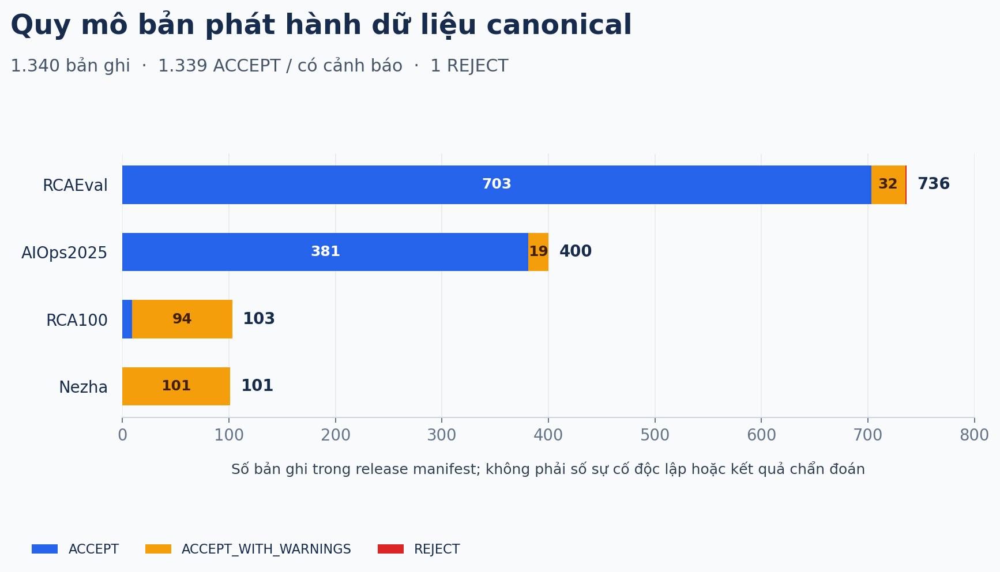
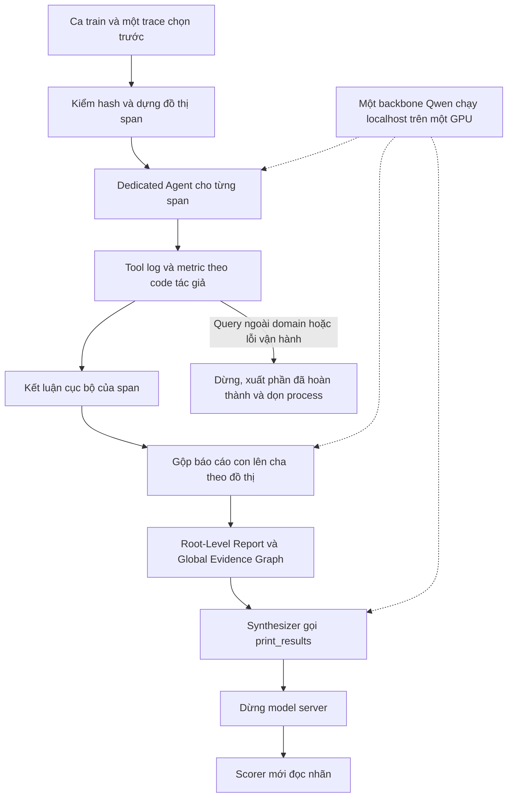
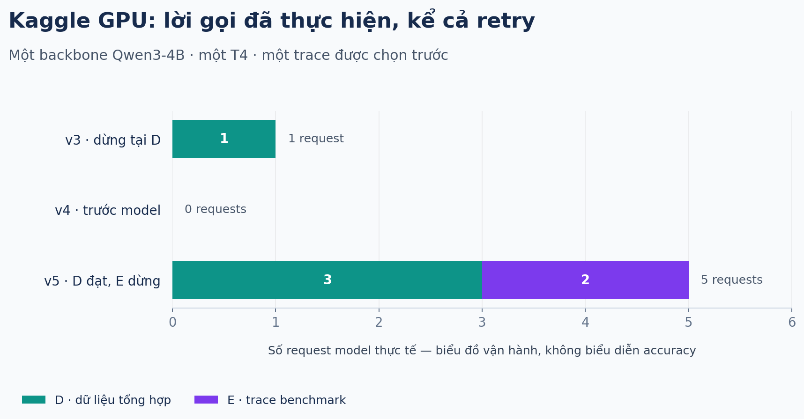

# NT114 · Root Cause Analysis khi thiếu telemetry

Nghiên cứu chẩn đoán nguyên nhân gốc trong hệ thống microservices khi metric, log hoặc trace không đầy đủ. Hướng hiện tại là **kiểm khả năng chạy RCLAgent với một backbone open-weight, giữ cơ chế đệ quy**, trước khi thiết kế và đánh giá các thay đổi cho bài toán thiếu telemetry.

> [!IMPORTANT]
> **Trạng thái đã kiểm:** trên Kaggle T4, lượt một trace train (version 8) chạy trọn A–F: 106 model requests trong 1.332,9 giây, có kết quả cuối và điểm chấm của scorer tác giả cho riêng trace đó. Đây là smoke một trace, **chưa phải accuracy hay kết quả tái hiện Table I**. Harness đã chạy được nhiều trace train theo lô; pilot 5 trace chưa chạy, chờ duyệt.

| Bài nền | Dữ liệu phát hành | Lượt GPU hiện tại |
|---|---|---|
| RCLAgent, arXiv v1 | 1.340 bản ghi canonical, 4 nguồn | 1 ca train · 1 trace · 33 span |
| Giữ recursion-of-thought | 1.339 ACCEPT / có cảnh báo; 1 REJECT | A–F đạt · 106 requests |

## Bài báo nền và nguồn kế thừa

**Lingzhe Zhang et al. (2026), _Towards In-Depth Root Cause Localization for Microservices with Multi-Agent Recursion-of-Thought_ — RCLAgent.**

- [Bài đã đọc: arXiv:2605.14866v1](https://arxiv.org/abs/2605.14866v1).
- [Code tác giả](https://github.com/LLM4AIOps/RCLAgent-V2), ghim commit [`3052e7a6`](https://github.com/LLM4AIOps/RCLAgent-V2/tree/3052e7a6a9598d984ba1482f3dc41123c8823a99), giữ giấy phép MIT.
- Kế thừa cách chia bài toán theo đồ thị trace, kiểm bằng chứng ở từng span, gộp báo cáo theo cấu trúc gọi và tổng hợp chẩn đoán cuối. Một backbone phục vụ các vai; lần thử hiện tại không dùng judge hoặc escalation.
- Bài nền được chọn có điều kiện. Bản đã thẩm định là **arXiv v1**; chưa đối chiếu số liệu với bản TDSC. Thay backbone bằng Qwen 4B chỉ kiểm khả năng thực thi cấu hình thay thế.

Lý do chọn và các điểm phản chứng nằm trong [selection memo](plans/261024-0858-tong-quan-1000-q1-chon-bai-nen-rca-thieu-telemetry/research/selection-memo.md). Các quyết định mới nhất nằm trong [decision log](plans/261018-2300-single-llm-simplification-and-evaluation-hardening/decisions.md); tài liệu thiết kế cũ được giữ làm lịch sử.

Benchmark chính cho lượt thử là [RCAEval](https://github.com/phamquiluan/RCAEval), [bản dữ liệu Zenodo 14590730](https://zenodo.org/records/14590730). Các nguồn Nezha, AIOps2025 và RCA100 thuộc kho canonical của dự án, chưa được dùng trong lượt Kaggle này.

## Dữ liệu có bao nhiêu?

### Kho canonical của dự án

Số liệu sau lấy từ [release manifest](nt114-rca/nt114-rca/releases/nt114-data-v1.json), bản `nt114-data-v1-20261014-6fdd9835`. Đây là **bản ghi sau chuẩn hóa**, không mặc nhiên là các sự cố độc lập và không phải số ca đã chạy LLM.

| Nguồn | ACCEPT | ACCEPT_WITH_WARNINGS | REJECT | Tổng bản ghi |
|---|---:|---:|---:|---:|
| RCAEval | 703 | 32 | 1 | 736 |
| AIOps2025 | 381 | 19 | 0 | 400 |
| RCA100 | 9 | 94 | 0 | 103 |
| Nezha | 0 | 101 | 0 | 101 |
| **Tổng** | **1.093** | **246** | **1** | **1.340** |

Bundle canonical có **3.263 file, 10.673.010.725 byte**. [Hugging Face dataset private](https://huggingface.co/datasets/siinn1706/nt114-rca-data) là nơi chuyển dữ liệu; mã và tài liệu ở GitHub. Nhãn nằm trong vùng `eval_only`, tách khỏi đầu vào suy luận theo [data contract](nt114-rca/nt114-rca/docs/data_contract.md). Tập train phục vụ những vai được quy định trong giao thức; dự án hiện không thực hiện fine-tuning.

### Phạm vi thử RCLAgent trên Kaggle

RCAEval gốc có 735 ca: RE1 = 375, RE2 = 270, RE3 = 90. Subset **RE2-OB có 90 ca**. Lượt version 8 chỉ dùng:

| Thành phần | Phạm vi thực tế |
|---|---|
| Ca | `checkoutservice_cpu_2`, vai train |
| Trace | `68791e1f360d910bd01428c3cd9748ef` |
| Cấu trúc | 33 span, root `6752e26884a7fee8` |
| Metric | 66.846 dòng: mọi cửa sổ endpoint tác giả quanh các giây model có thể hỏi |
| Log | 1.747 dòng theo cùng cửa sổ; không bổ sung tín hiệu |
| Nhãn | 1 dòng tách trong `scoring/`, chỉ dành cho chấm sau chạy |
| Kiểm rút gọn | 822 phản hồi endpoint khớp byte giữa gói tối thiểu và dữ liệu đầy đủ |

Nguồn máy đọc: [manifest](plans/261026-1713-rclagent-tai-hien-toi-thieu/kaggle/manifest.json), [CPU equivalence](plans/261026-1713-rclagent-tai-hien-toi-thieu/kaggle/cpu-equivalence.json). Không chọn riêng những metric có vẻ bất thường để rút dữ liệu.

## Flow đang kiểm

Flow trên mô tả đường thực thi được giữ trong harness. Version 8 đi hết flow này với model thật trên một trace: kiểm span, gộp đệ quy, synthesizer, rồi scorer. Một trace không đủ để đánh giá độ chính xác.

## Kết quả chạy thực tế trên Kaggle

**Backbone:** `Qwen/Qwen3-4B-Instruct-2507`, revision `cdbee75f17c01a7cc42f958dc650907174af0554`. **Serving:** vLLM 0.10.2 V0, FP16, Hermes tool parser, localhost; một T4, context 16.384, concurrency 1.

| Giai đoạn của version 8 | Kết quả |
|---|---|
| A · Môi trường | Kaggle cấp T4, chỉ dùng GPU 0; không cộng VRAM |
| B · Thư viện và kernel | Cài trong venv; bản vá kernel attention qua các kiểm GPU |
| C · Model server | Nạp đúng revision và ready trên localhost |
| D · Tool-calling tổng hợp | **Đạt**, 3 requests |
| E · Một trace benchmark | **Đạt**, 106 requests trong 1.332,9 giây; 38 kết quả `search_logs`, 1 kết quả được rút gọn theo ngân sách |
| F · Export, scorer và cleanup | Có kết quả cuối, scorer tác giả đã chạy cho trace này, process đã dọn |

Lỗi kernel gốc cần 98.304 byte shared memory trên T4 giới hạn 65.536 byte. Patch chỉ đổi tile truy vấn 128 → 64 trên Turing, giữ source gốc, diff và hash; không đổi RCLAgent. Sai số tuyệt đối lớn nhất trong 15 kiểm attention là 0,000248.

Các lượt trước đều dừng ở E và được giữ trong báo cáo. Version 5 dừng vì guard domain cũ chặn `cartservice`. Version 6 dùng gói theo cửa sổ query nên query đó chạy được, nhưng phản hồi `search_logs` cần 126.088 token, vượt context. Version 7 thêm ngân sách 2.048 token cho `search_logs` (rút gọn có thông báo, không bỏ dòng nào) và chạy tới request 60, rồi dừng vì một timestamp nằm ngoài toàn bộ dữ liệu. Version 8 cho guard chấp nhận timestamp như vậy, vì tool tác giả trên dữ liệu đầy đủ cũng chỉ trả "No matching records found.".

Trần vẫn là **160 model requests gồm retry, 30 phút** mỗi trace, vòng tool/retry hữu hạn. Không cắt context, đổi model, mở rộng dữ liệu hoặc retry theo nhãn để tìm kết quả tốt hơn. Chi tiết: [summary version 8](plans/261026-1713-rclagent-tai-hien-toi-thieu/kaggle/kaggle-repair-v8-summary.json), [thiết kế ngân sách](plans/reports/design-261027-1155-tool-result-budget.md), [repair report](plans/261026-1713-rclagent-tai-hien-toi-thieu/kaggle/repair-report.md).

## Chạy và đọc code ở đâu?

- **Kaggle GPU:** [notebook](plans/261026-1713-rclagent-tai-hien-toi-thieu/kaggle/rclagent-kaggle-smoke.ipynb), [bundle ZIP private tại revision đã kiểm](https://huggingface.co/datasets/siinn1706/nt114-rca-data/resolve/2e7d80c144d5f28d13e8ed1888c7bc83b8c7fdc1/reproductions/rclagent-smoke-261026/rclagent-kaggle-bundle.zip) và [hướng dẫn](plans/261026-1713-rclagent-tai-hien-toi-thieu/kaggle/README.md). Link ZIP trỏ tới bản phát hành trước version 6. Notebook trong repo là bản chạy theo lô cho pilot 5 trace train, chưa chạy.
- **Pipeline NT114:** [hướng dẫn kỹ thuật](nt114-rca/nt114-rca/README.md), [source](nt114-rca/nt114-rca/src/rca), [tests](nt114-rca/nt114-rca/tests), [hợp đồng dữ liệu](nt114-rca/nt114-rca/docs/data_contract.md).
- **Khảo cứu và quyết định:** [tổng quan bài nền](plans/261024-0858-tong-quan-1000-q1-chon-bai-nen-rca-thieu-telemetry/plan.md), [decision log](plans/261018-2300-single-llm-simplification-and-evaluation-hardening/decisions.md).
- **R-a/IM1 đã viết nhưng tạm hoãn:** [điểm dừng thực tế](plans/261026-0928-nhanh-a-im1-trien-khai-kha-thi/work/stop-point.md). R-a là adaptation một lời gọi đã bỏ recursion-of-thought; không gọi là tái hiện đầy đủ. Chưa có kết quả model của các arm này.
- **Xuất bản và artifact:** [hướng dẫn GitHub/Hugging Face](docs/publication.md). Full-text PDF, credential, runtime, cache và dữ liệu/telemetry thô không được commit vào Git.

## Giới hạn của bằng chứng hiện tại

Chưa có accuracy, kết quả Table I, best-of-traces, confidence cuối cho H1 hoặc hiệu quả IM1. Điểm chấm của version 8 chỉ thuộc một trace smoke. Ngân sách `search_logs` làm phản hồi của một số query lệch khỏi tác giả; mọi kết quả phải ghi rõ là adaptation (4B, context 16k, có ngân sách tool result). Các quyết định đóng băng/đánh giá, lịch sử tiếp xúc test và vai trò train/val/test được giữ trong giao thức; không diễn giải fixture, kế hoạch hay đầu ra mô phỏng thành kết quả nghiên cứu.

Các biểu đồ được dựng từ manifest/summary bằng [script](plans/261026-2141-publish-latest/build-readme-charts.py); [provenance](plans/261026-2141-publish-latest/chart-provenance.json) ghi hash nguồn, số đếm và phiên bản thư viện. Chúng thể hiện dữ liệu và vận hành, không thể hiện độ chính xác.
