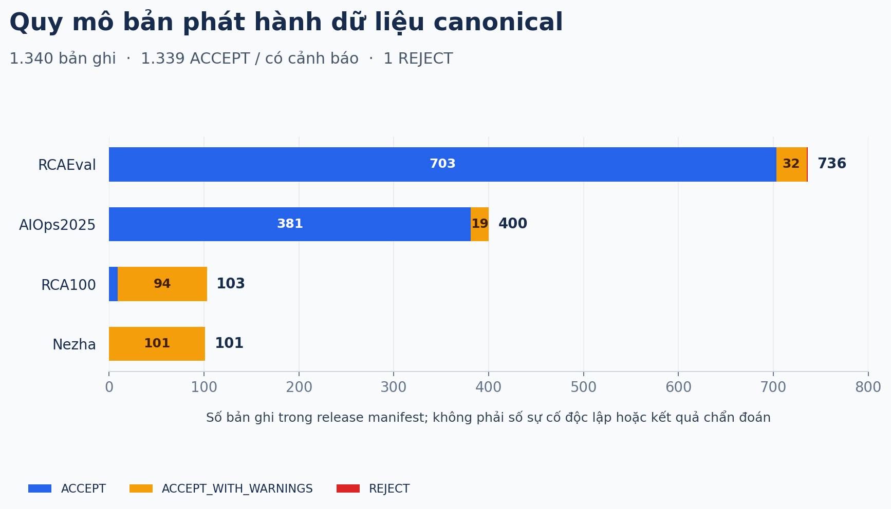
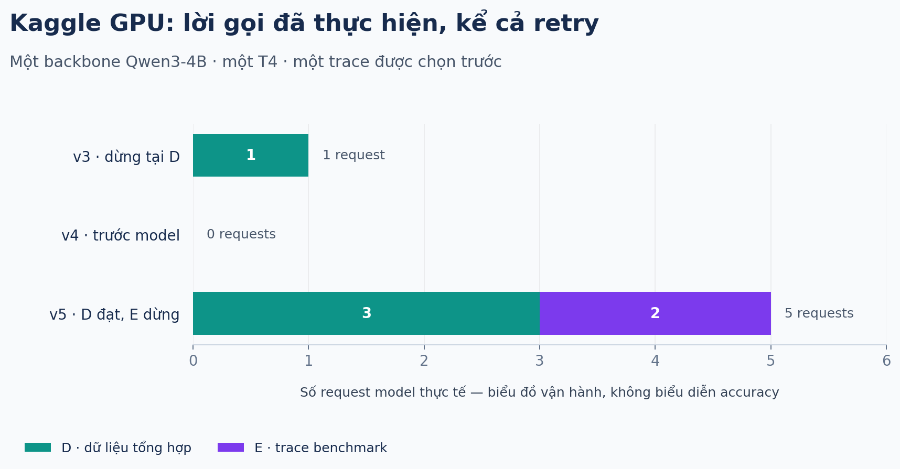

# NT114 · Dữ liệu RCA và artifact tái hiện RCLAgent

Kho **private, dành cho nhóm dự án** chứa bundle canonical đã kiểm toàn vẹn và artifact của lần thử RCLAgent trên Kaggle GPU. [Mã và README dự án trên GitHub](https://github.com/siinn1706/NT114) giải thích bài nền, flow, phạm vi và trạng thái nghiên cứu.

> **Trạng thái thực nghiệm:** bản sửa chạy được trên T4 và qua tool-calling tổng hợp; một trace benchmark dừng vì model yêu cầu service ngoài domain gói. Chưa có kết quả RCA cuối, accuracy hoặc tái hiện Table I.

## Bài nền

Lingzhe Zhang et al., **Towards In-Depth Root Cause Localization for Microservices with Multi-Agent Recursion-of-Thought**, [arXiv:2605.14866v1](https://arxiv.org/abs/2605.14866v1). [RCLAgent-V2](https://github.com/LLM4AIOps/RCLAgent-V2) được ghim tại `3052e7a6a9598d984ba1482f3dc41123c8823a99`.

Lần thử giữ cơ chế đệ quy của tác giả, thay backbone bằng `Qwen/Qwen3-4B-Instruct-2507`, revision `cdbee75f17c01a7cc42f958dc650907174af0554`; một model, một GPU, server localhost. Đây là kiểm thực thi với cấu hình thay thế, chưa phải tái hiện số liệu bài báo.

## Kho canonical hiện có

Thư mục `nt114-data-v1-20261014-6fdd9835/` giữ nguyên. Code revision của bundle là `cd96e9e8dc1906ee287cc54e9f02fe4b6b75a55e`, không phải revision mới nhất của pipeline.

| Nguồn | ACCEPT | Có cảnh báo | REJECT | Tổng bản ghi |
|---|---:|---:|---:|---:|
| RCAEval | 703 | 32 | 1 | 736 |
| AIOps2025 | 381 | 19 | 0 | 400 |
| RCA100 | 9 | 94 | 0 | 103 |
| Nezha | 0 | 101 | 0 | 101 |
| **Tổng** | **1.093** | **246** | **1** | **1.340** |

Đây là số bản ghi chuẩn hóa theo release manifest, không phải số sự cố độc lập hay số ca đã chạy model. Bundle có **3.263 file**, **10.673.010.725 byte**; `MANIFEST.sha256` hash `1a51a7c5e2e611aeb6a2ce1dd88267e03f03357db94eccdd5544cca4345a5712`; `bundle.json` hash `26d10fa7707715769f0c430e4b3bca1024b6500bcd680fe01eeef7c22f3ac7ae`.

## Gói RCLAgent mới

Thư mục [reproductions/rclagent-smoke-261026](https://huggingface.co/datasets/siinn1706/nt114-rca-data/tree/main/reproductions/rclagent-smoke-261026) chứa notebook, gói đầu vào tối thiểu, manifest/checksum, báo cáo CPU parity và các archive native có cả lần thất bại. Lấy đúng file/hash trong [artifact-manifest.json](https://huggingface.co/datasets/siinn1706/nt114-rca-data/blob/main/artifact-manifest.json).

| Dữ liệu/lượt chạy | Phạm vi |
|---|---|
| Nguồn benchmark | [RCAEval RE2-OB](https://zenodo.org/records/14590730), subset gốc 90 ca |
| Được đóng gói | Một ca train `checkoutservice_cpu_2`, một trace 33 span |
| Metric/log | 38.048 dòng metric; 0 dòng log sau đúng lọc tác giả |
| Nhãn | Một dòng tách ở `scoring/`, không cấp cho model |
| Parity | 86 phản hồi tool khớp byte giữa gói tối thiểu và dữ liệu đầy đủ |
| Native mới nhất | D đạt với 3 requests; E dừng sau 2 requests, khoảng 24,94 giây |
| Kết quả cuối/chấm | Chưa có; mọi process đã được dọn |

Input, raw inference log và nhãn có vai trò riêng: **không ghép chúng thành đầu vào model**. Các ZIP kết quả dùng để audit sau chạy, không dùng để retry hoặc chọn đáp án. Đầu ra tổng hợp một trace không có confidence cuối cho H1. R-a/IM1 vẫn tạm hoãn, không có kết quả model trong đợt này.

Metadata phản hồi khảo cứu được lưu riêng trong `research/literature-261024-records.zip` để bảo toàn provenance; không kèm PDF hoặc bản trích toàn văn. Những bảng metadata này không phải tập huấn luyện hoặc dữ liệu benchmark RCA.

## Tải và kiểm toàn vẹn

Đăng nhập HF bằng credential lưu trong secret store/CLI của bạn, không đặt token vào notebook. Tải file tại revision được ghi ở receipt phía GitHub để kiểm đúng snapshot. Với canonical bundle, chạy `sha256sum -c MANIFEST.sha256` bên trong thư mục bundle; với artifact mới, so SHA256 từng file theo `artifact-manifest.json`. Notebook chỉ nhận bundle đầu vào và kiểm hash riêng của nó.

## Quyền sử dụng và cách ly nhãn

| Nguồn | Giấy phép |
|---|---|
| RCAEval / Zenodo | CC BY 4.0 |
| Nezha | MIT |
| AgenticOpsEval AIOps2025 | CC BY-NC 4.0 |
| AgenticOpsEval RCA100 | CC BY-NC-SA 4.0 |
| RCLAgent source trong gói | MIT |

Giữ bản quyền của từng nguồn; các phần AgenticOpsEval chỉ dùng cho nghiên cứu phi thương mại theo điều khoản nguồn. **Không chuyển repo sang public.** Canonical `eval_only/` chứa ground truth chỉ dành cho mã đánh giá/điều kiện/split được phép; không đưa vào prompt, evidence, dữ liệu huấn luyện hoặc repo công khai. Nhãn của gói smoke cũng chỉ dành cho scorer sau inference. Credential, transcript, toàn văn có bản quyền và thư mục dự án đầy đủ không được đưa vào lần bổ sung artifact này.
