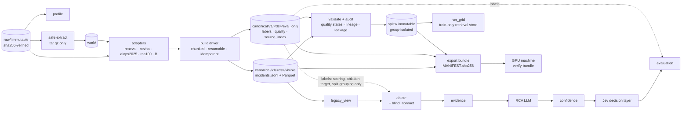

# NT114-RCA: research-grade dataset standardization and portable data pipeline

## Outcome

Every scientifically usable incident from the acquired raw datasets exists once, in a versioned
`CanonicalIncident` store. Each incident has an opaque id, time-aligned telemetry in Parquet, an
explicit per-modality missingness status, ground truth kept in a separate evaluation-only zone,
and a quality state. Immutable split manifests isolate repeated injections and overlapping
windows. The existing pipeline (`ablate → evidence → retrieve → run_grid`) consumes the store
through a thin compatibility view, and a hash-verified bundle reproduces everything on the Linux
GPU machine without re-running preprocessing.

`blockedBy` refers to the acquisition plan, whose outputs (raw data, checksums, lineage registry)
are reused as-is. OpenRCA acquisition there is still PENDING and does not block this plan.

## Scope

- **In:** audit, profiling, schema, adapters, normalization, validation, lineage and duplicate
  audit, leakage controls, missing-observability conditions, splits, minimal integration with
  existing modules, export and portability, data-contract docs, handoff for LLM + Jev.
- **Out (non-goals):** downloading data (including OpenRCA), LLM training or inference, live Jev
  calls, prompt changes, a pipeline rewrite, changes to `llm.py`, `gate.py`, `metrics.py`,
  `analyze.py`, `retrieve.py`, `evidence.py`.

## Constraints

- Raw data under `RCA_ROOT/data/raw/` is read-only. `sha256sum -c data/manifests/checksums.sha256`
  must pass before and after.
- Raw archives are streamed when possible; only tar.gz that cannot be streamed (AIOps2025) is
  extracted into `data/work/` with the safe-extraction rules.
- No code from the raw data is executed. Never run Python with the working directory inside
  `data/raw/` or `data/work/extract/`.
- No label is fabricated, renamed or inferred. Unknown values are explicit; every exclusion or
  correction has a finding or a reviewed override.
- Ground truth may select an ablation target; it never enters evidence, prompts, features,
  retrieval queries or Jev state.
- All stored paths are relative POSIX; all text is UTF-8.
- Existing behaviour is preserved except the justified fixes D1–D12 listed in the audit.

## Evidence base (planning scout, 2026-10-14)

- [research/repo-audit.md](research/repo-audit.md): what was acquired, raw formats, 12 defects in
  the current pipeline (D1–D12), duplicates and label inconsistencies.
- [research/compatibility-matrix.md](research/compatibility-matrix.md): per-dataset matrix,
  A/B/C tiers, promotion gates.
- Design: [canonical schema](design/canonical-schema.md),
  [adapter contracts](design/adapter-contracts.md),
  [quality, leakage, splits](design/quality-leakage-splits.md),
  [CLI and portability](design/cli-and-portability.md),
  [LLM + Jev handoff](design/handoff-llm-jev.md).
- [test-matrix.md](test-matrix.md), [risks.md](risks.md).

### Verified facts versus assumptions

| Verified during planning (read from files) | Still an assumption (phase 02 resolves it) |
|---|---|
| 10 sources VERIFIED, 47.8 GB; 2,320 independent incidents in the lineage registry | Nezha metric `TimeStamp` offset prevalence across all files |
| RCAEval Zenodo has 736 case dirs; `multi-source-data` duplicates `checkoutservice_cpu/1` | AIOps2025 archive time zone (31 incidents fall on UTC dates without an archive) |
| `data.py` mislabels 3 RE3-TT `ts-route-service_f3_1` incidents (D1) | RCA100 share of service-resolvable root entities |
| Zenodo RE3-SS ships 8 `root_cause.txt` (the audit doc says HF-only) | RCABench, AnoMod and MSDS label formats |
| Windows cp1252 default breaks UTF-8 JSON reads (reproduced) | DejaVu incident counts |
| Evidence files store `root_service`; retrieval store is not split-aware (D3, D4) | Canonical size on disk (estimated 10–25 GB) |
| System Python has no pandas/pyarrow; requirements are unpinned | |

## Classification summary

| Tier | Datasets |
|---|---|
| A (service-level evaluation) | RCAEval RE2+RE3 (primary), RCAEval RE1 (natural metric-only), Nezha (after gate), AIOps2025 service+pod faults, RCA100 (if gate passes) |
| B (auxiliary) | AIOps2025 node faults, Cloud-OpsBench, PetShop, DejaVu (RCA100 if gate fails) |
| C (excluded or pending) | RCAEval HF copy, OpenRCA (not acquired), RCABench/AnoMod/MSDS until a gate passes, GAIA, Eadro, LEMMA, LO2, AIOps 2020/2021 archives |

## Architecture

The LLM, confidence and Jev boxes belong to the next plan; this plan fixes their data inputs
([handoff](design/handoff-llm-jev.md)).

## Phases

| # | Phase | Depends on | Effort | Key output |
|---|---|---|---|---|
| 01 | [Baseline audit, environment lock, golden set](phase-01-baseline-audit-and-environment.md) | — | 0.5d | `.venv`, lock file, golden hashes, D11 doc fix |
| 02 | [Raw profiling and compatibility gates](phase-02-raw-profiling-and-compatibility-gates.md) | 01 | 2d | profiles, gate decisions, final A/B/C |
| 03 | [Canonical schema, store, adapter contract](phase-03-canonical-schema-store-and-adapter-contract.md) | 02 | 2d | JSON Schema, `schema.py`, `store.py`, `identity.py`, `adapters/base.py` |
| 04 | [Processing infrastructure and CLI](phase-04-processing-infrastructure-and-cli.md) | 03 | 2.5d | `safe_extract.py`, `prep.py` driver, `quality.py` |
| 05 | [RCAEval reference adapter and legacy view](phase-05-rcaeval-reference-adapter.md) | 04 | 3d | canonical RCAEval, `legacy_view.py`, D1 fix |
| 06 | [Nezha adapter](phase-06-nezha-adapter.md) | 05 | 2d | canonical Nezha |
| 07 | [AIOps2025 and RCA100 adapters](phase-07-aiops2025-and-rca100-adapters.md) | 05 | 3d | canonical AIOps2025, RCA100 |
| 08 | [Auxiliary adapters and gated sources](phase-08-auxiliary-adapters-and-gated-sources.md) | 05 | 2d | canonical PetShop, DejaVu, Cloud-OpsBench; gate records |
| 09 | [Cross-dataset quality, lineage, leakage](phase-09-cross-dataset-quality-lineage-and-leakage.md) | 05 (re-run after 06/07, 08) | 2d | audit report, leakage suite |
| 10 | [Missingness conditions and splits](phase-10-missingness-conditions-and-splits.md) | 09 | 2.5d | `blind_nonroot`, `exclude_ids` store mask, condition matrices, split manifests |
| 11 | [RCA module integration](phase-11-rca-module-integration.md) | 10 | 2d | `run_grid` canonical path, `VisibleCase`, train-only store |
| 12 | [Export, portability, docs, handoff](phase-12-export-portability-docs-and-handoff.md) | 11 | 1.5d | bundle, Linux verification, `docs/data_contract.md` |

### Milestones (owner decision R2: full scope kept, delivered in shippable slices)

| Milestone | Phases | Delivers | Unblocks |
|---|---|---|---|
| M1 (~16d) | 01–05, then 09–12 on RCAEval only | Canonical RCAEval, leakage suite, conditions, RCAEval splits, integrated `run_grid`, first bundle | The LLM + Jev plan can start |
| M2 (~6d + re-runs) | 06, 07, then re-run 09, 10, 12 | Nezha, AIOps2025, RCA100; cross-dataset protocols; bundle v2 | Second-benchmark and cross-dataset results |
| M3 (~2d + re-run) | 08, then re-run 09, 12 | B datasets; gated-source decisions | Auxiliary training and robustness |

**Status 2026-10-14.** M1 and M2 are delivered on the prep machine: phases 01–07 and 09–11
completed, phase 12 bundle exported and verified on Windows. Release `nt114-data-v1`: code
commit `cd96e9e` on GitHub branch `release/nt114-data-v1`, bundle
`nt114-data-v1-20261014-6fdd9835` in the private HF dataset `siinn1706/nt114-rca-data`. M1/M2
acceptance and phase 12 stay in progress until `scripts/verify_portability.sh` passes on the GPU
machine (Linux); the owner skipped a local Docker preflight. Phase 08 (M3) is deferred by owner
decision; nothing in M1/M2 depends on it. Reports:
[phases 09–11](reports/phase-09-11-audit-splits-integration.md),
[phase 12](reports/phase-12-portability.md),
[release handoff](reports/release-handoff-nt114-data-v1.md).

Phases 06, 07 and 08 are independent of each other after 05. Re-runs of 09, 10 and 12 reuse
the same code; only new datasets are processed. Deep mode: before cooking each phase from 02 on,
run a short scout of the files it touches and update the phase if the code or data moved.

## Files

**Create** (all under `RCA_ROOT`): `schemas/canonical_incident.v1.schema.json`;
`src/rca/{profile,schema,store,identity,safe_extract,prep,quality,legacy_view,audit,splits,bundle}.py`;
`src/rca/adapters/{__init__,base,rcaeval,nezha,aiops2025,rca100,petshop,dejavu,cloud_opsbench}.py`;
`configs/{prep.yaml,service_aliases.yaml,quality_overrides.yaml,canonical_synthetic.yaml,canonical_pilot.yaml}`;
`tests/{test_profile,test_schema,test_store,test_identity,test_safe_extract,test_prep_driver,test_quality,test_adapter_rcaeval,test_adapter_nezha,test_adapter_aiops2025,test_adapter_rca100,test_adapters_aux,test_audit,test_leakage,test_conditions,test_splits,test_legacy_compat,test_legacy_golden,test_run_grid_canonical,test_bundle,test_realdata_samples}.py`;
`tests/fixtures/build_fixtures.py`; `tests/golden/synthetic_evidence.sha256`; `pytest.ini`;
`requirements-lock.txt`; `.gitattributes`; `scripts/verify_portability.sh`; `docs/data_contract.md`.

**Modify:** `src/rca/data.py` (`VisibleCase`/`Truth`, D1 parser with batch-aware unique
`case_id`, UTF-8), `src/rca/ablate.py` (`mask_service_traces`, `blind_nonroot`),
`src/rca/retrieve.py` (`exclude_ids`; no reads of query labels), `src/rca/run_grid.py`
(canonical source, `VisibleCase` to model-facing calls, label-free evidence, train-role store
evidence, split-aware store, condition matrix, UTF-8, relative paths), `requirements.txt`
(`jsonschema`), `.gitignore` (`!data/reports/`, `!data/splits/`), `README.md`,
`docs/dataset_quality_audit.md`.

**Preserve unchanged:** `src/rca/{evidence,llm,gate,metrics,analyze}.py`,
`configs/{pilot,synthetic}.yaml`, `tests/test_pipeline.py`, `tests/test_datasets_acquire.py`,
`scripts/datasets/*`, `scripts/make_synthetic.py`, `data/raw/`, `data/manifests/`,
`data/provenance/`, `data/.state/`.

## Acceptance criteria

| Area | Measurable criterion | Checked by |
|---|---|---|
| Parsing | 100% of discovered incidents in every enabled dataset have a record in all three record files; 0 `ADAPTER_EXCEPTION` in final builds | `prep status`, T06 |
| Label validity | 100% of A-tier incidents have `label_validity=valid` and `primary_root_service ∈ candidates`, or are QUARANTINE/REJECT with a finding; RE3-TT `f3_1` cases labelled `route`/`f3` | T08, T09, audit |
| Integrity | Raw `sha256sum -c` exit 0 before and after; two builds give identical JSONL bytes and `content_sha256` | phase 01, 05 |
| Provenance | Every canonical incident with a registry counterpart maps to exactly one `incidents.jsonl` row; every telemetry row has `src_file`/`src_row` | T15, audit |
| Completeness | For every built dataset of the milestone, counts reconcile with `lineage-report.json` (M1: RCAEval 735 + 1 duplicate; M2: Nezha 101, AIOps2025 400, RCA100 103; M3: Cloud-OpsBench 754, PetShop 68) or each difference is explained | audit, phase 08 |
| Missingness | Every modality status is one of the four values; generated conditions equal the condition matrix (applicable, ≥1 modality remains, anchor precondition); `blind_nonroot` never targets the root | T17, T19 |
| Leakage | Canary absent everywhere visible; model-facing calls receive `VisibleCase` only; permutation invariance (test-role labels) holds for evidence, `precedent` retrieval prompts and Jev states; 0 denylist/path/artefact hits on real builds; store non-empty and train-only; Jev payload keys ⊆ allowlist with `hit_top_sim` from `precedent` only | T16, T19 |
| Split isolation | 0 groups spanning splits (per protocol rule); all variants of an incident share its split; re-running a split reproduces its hash; only phase-02-feasible protocols generated | T18, `verify-splits` |
| Compatibility | `tests/test_pipeline.py` and the golden synthetic comparison pass; evidence text and features for real RCAEval cases identical through `legacy_view`; legacy `case_id`s unique | T01, T02, T10 |
| Portability | `verify-bundle` exit 0 on Linux; 100% `content_sha256` equality; fast suite green on Windows and Linux | T20, T21 |

## Resource estimates

| Resource | Estimate | Basis |
|---|---|---|
| People / time | ~25 person-days: about 5 weeks for one person, about 3 weeks for two (06/07/08 in parallel) | phase efforts |
| Disk | `work/extract` ~12 GB (AIOps2025, deletable); canonical A+B 10–25 GB; bundle = canonical + reports + splits; F: has 787 GB free | raw sizes, Parquet compression of the 3.4 GB HF RCAEval copy |
| RAM | ≤ 8 GB peak with `chunk_rows: 500000`, `max_workers: 2` (verified per source by the profile's largest member) | streaming design |
| CPU time | RCAEval build ~1–2 h, AIOps2025 extraction + build ~2–3 h, others < 1 h each; raw re-hash ~5 min | sizes; to be replaced with measured times in phase reports |
| Network | none (bundle transfer only) | — |

## Definition of Done

1. All acceptance criteria above are met, with evidence in phase reports under `reports/`.
2. Fast test suite green on Windows and on Linux; realdata suite green on the prep machine.
3. `data/reports/` contains profile, compatibility, quality, audit and condition-matrix reports;
   `data/splits/` contains the listed manifests; both are committed.
4. `docs/data_contract.md` exists and every link and number in it is verified.
5. The bundle passes `verify-bundle` on the target Linux environment.
6. The handoff checklist in [design/handoff-llm-jev.md](design/handoff-llm-jev.md) is complete.
7. No open QUARANTINE item lacks an owner decision or a recorded reason for staying quarantined.

## Handoff to the LLM + Jev plan

See [design/handoff-llm-jev.md](design/handoff-llm-jev.md): interfaces (`CanonicalStore`,
`legacy_view`, `ablate`, splits, bundle), the Jev decision-state allowlist, backbone
independence, and the items left for the next plan.

## Validation Log

### Session 1 (2026-10-14)

| # | Question | Decision | Propagated to |
|---|---|---|---|
| V1 | Bundle contents | Canonical only (visible, eval_only, splits, reports, manifests, provenance); raw stays on the prep machine | phase 12 task 3 (`--include-raw` remains available but unused) |
| V2 | RCA100 answer key on the GPU machine | Allowed inside `eval_only` of the private bundle; never in prompts or public repos; restriction recorded in `bundle.json` | phase 07 task 4, phase 12 task 2 |
| V3 | AIOps2025 node and multi-entity faults | Node → B. Multi-entity with one named service → A (top-1). Otherwise A `set-scoring-only` (no top-1, no `blind_*`) | design/adapter-contracts §3.3, design/canonical-schema invariant 8, phase 07 tests |
| V4 | B adapters | Kept in this plan as phase 08 (P3), after A; not blocking 09–12 | phase 08 (unchanged) |

### Verification Results

- Checked against `cat -n` output and raw listings during planning: every line reference in
  D1–D12, every raw-data fact in the left column of "Verified facts versus assumptions", the
  `acquire.py` subcommands, and the lineage counts.
- Failed: 0. Unverified: the 6 items in the right column of that table; phase 02 resolves them.
- Tier: Full (12 phases).

### Session 2 (2026-10-14, after red team)

| # | Question | Decision | Propagated to |
|---|---|---|---|
| R1 | Retrieval design (F2, F4) | Two protocols: `within-*-retrieval` (physical grouping, precedents kept) and `within-*-grouped` (cell grouping). `precedent` = label-free headline and the only Jev source; `no_precedent` = oracle ablation | design/quality-leakage-splits §4–5, phases 10, 11, handoff |
| R2 | Scope (F8) | Keep full scope; add milestones M1/M2/M3 with M1 RCAEval-only as the first shippable slice | Phases table, phase 09 note, acceptance criteria |
| R3 | Anchor visibility | Label-file anchor times may place evidence windows (standard practice); never shown as text; recorded as a threat to validity | design/quality-leakage-splits §6, phase 12 docs |

## Red Team Review

One hostile reviewer covered all four lenses (assumptions, failure modes, leakage and science,
scope). It returned 14 findings, all with file:line evidence. F3 and F9 were confirmed against
the raw data.

| ID | Severity | Finding | Disposition | Applied in |
|---|---|---|---|---|
| F1 | Critical | Labels reach model-facing code via the `Case` object; import scan cannot detect it | Accept | D13; `VisibleCase`/`Truth` in phase 05, 11; T16 type guard |
| F2 | Critical | `no_precedent` mask uses query labels; its `hit_top_sim` feeds Jev | Accept (R1) | D14; `exclude_ids` in phase 10; Jev allowlist; T16 retrieval permutation |
| F3 | High | D1 fix makes `case_id`s collide (`f3` vs `f3_1`); 3 cases silently skipped; `routef3` was wrong | Accept | batch in `case_id`, uniqueness assert, T08; audit corrected to `routeservicef3` |
| F4 | High | Cell grouping removes all precedents from the train store | Accept (R1) | retrieval protocol with physical grouping |
| F5 | High | Nezha overlap grouping collapses whole days | Accept | overlap on evidence window; phase-02 group-count measurement; Nezha eval-only + xdata |
| F6 | High | Train-only store built from evidence never prepared | Accept | phase 11 prepares all train-role `full` evidence; T19 non-empty/equality |
| F7 | High | `legacy_case` undefined; `case_id` choice changes prompts | Accept | canonical `case_id = incident_uid`; T10 limited to evidence text and features |
| F8 | High | 25d over-built for 1–2 people | Partially accept (R2) | milestones; full scope kept per owner |
| F9 | Medium | Exact-string `key_*` scan unsatisfiable; "no `_`" metric rule | Accept | free-text artefact scan only; original metric names kept, `.` encoding in legacy view |
| F10 | Medium | Natural strata confounded with release; non-injection anchors | Accept (modified) | within-release pairing, RE1 descriptive; anchor precondition allows `alert` when the pre-window is sufficient |
| F11 | Medium | `ablate.applicable` contradicts "no fake ablation" | Accept | condition matrix as the single source in the canonical path; ≥1 modality remains; T17 |
| F12 | Medium | Resume loses per-incident records | Accept | per-incident record files + markers, REJECTs included; finalize by concatenation |
| F13 | Medium | IPC-based hash unstable; tar stream cannot resume by offset | Accept | canonical row serialization hash; pinned pyarrow; per-member checkpoint re-stream |
| F14 | Medium | Acceptance depends on deferrable phase 08 | Accept | completeness scoped per milestone; B counts in phase 08 criteria |

Accepted 13, partially accepted 1, rejected 0.

### Whole-Plan Consistency Sweep

- Searched all plan files for the superseded terms: "IPC stream", "no `_`", "legacy_case",
  "routef3", "store holds train uids only", "`retrieve.py` unchanged", "dependencies: [6, 7]", and
  exact-string scans of `key_metrics`. Remaining hits were updated, or are deliberate history in
  this log.
- Reconciled: phases table and milestones, the Files lists (`retrieve.py` moved from preserved
  to modified), acceptance criteria, handoff interfaces, test-matrix rows T06/T08/T10/T16–T19,
  and the design docs.
- Unresolved contradictions: none.
