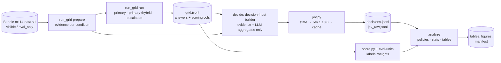

# Architecture: RCA LLM + mandatory Jev decision layer

Status: proposed for approval. Code paths are relative to `nt114-rca/nt114-rca/`.

## 1. Alternatives considered

| | A. Offline full-feedback grid + post-hoc Jev (**selected**) | B. Online sequential pipeline | C. Agentic tool-using LLM (OpenRCA-style) | D. Jev as the diagnoser |
|---|---|---|---|---|
| How | Run every LLM arm (primary, primary+retrieval, escalation) for every incident and condition, cache everything; Jev decides on stored states; outcomes are looked up | Jev picks an action, only that action runs | LLM queries telemetry with tools over several turns | Jev picks the root among candidates |
| Counterfactuals | Exact for every policy (all arms observed) | None; each policy needs its own run | None | – |
| Paired comparison | Yes, same incidents, same LLM outputs | Only if replayed | No | – |
| Cost | Each arm once; policies are free | Cheaper per policy, but no comparisons | High; long contexts | Cheap |
| Fits existing code | `run_grid` + `gate` already do this | New loop | New system | Contradicts the required architecture (LLM diagnoses, Jev decides) |
| Reproducibility | Cached raw outputs, deterministic replay | Run-dependent | Low | – |

A is selected. Online behaviour equals A's chosen path **only through the cache**: neither vLLM
batching nor Jev (no seed) is deterministic, so results are reproducible from cached outputs, not
by re-calling the models;
latency and tokens of a policy are summed along its chosen path. D is rejected for the default
architecture; Jev is documented as weak on "System Two" tasks.

## 2. Pipeline



Inference-visible zone: evidence text, candidates, LLM outputs, availability flags, retrieval
similarity (precedent store), Jev outputs. Evaluation-only zone: labels, `correct`, `rank`,
`truth`, `fault`, masked service, coverage cause, eval-unit weights. The boundary sits at the
**decision-input builder** in `decide.py`: Jev states are built only from evidence files and
named LLM aggregate fields, never from a whole grid row.

## 3. Components and responsibilities

| Component | File | Responsibility | Status |
|---|---|---|---|
| Canonical store, splits, conditions, evidence | `store.py`, `splits.py`, `ablate.py`, `evidence.py`, `legacy_view.py` | Frozen data layer | reuse |
| Evidence prep | `run_grid.prepare` | Unchanged | reuse |
| LLM client | `llm.py` | Prompt v1 frozen as `PROMPT_VERSION`; cache key adds prompt version, model revision, chat-template kwargs; `enable_thinking` option; optional top-logprobs | modify |
| Grid runner | `run_grid.run` | Adds `role: escalation` models, writes `prompt_version`, `model_revision`, uses `score.correctness`; writes `manifest.json` | modify |
| Scoring | `score.py` (new) | `Truth` → service-set; `rank_of_truth` for top-1 and set-scored records; joins `eval-units` (weight, injection, representative, coverage cause, exclusions) | new |
| Jev client | `jev.py` (new) | State builder (allowlist), question builder, TypeSafe client (other routes only if D1 requires), option-order randomisation, response validation, version guard, SQLite cache, retry on 429/529, `mock` backend | new |
| Decision runner | `decide.py` (new) | Builds its own action table keyed on `(incident_uid, condition)` with optional arms, builds decision inputs from evidence + LLM aggregates, calls Jev for stage 1 and stage 2 on every incident × condition, writes `decisions.jsonl`, `jev_raw.jsonl` | new |
| Policies and comparators | `gate.py` | Keeps `fixed`, `threshold_policy`, `learned_policy`, `evaluate`; adds Jev policies, coverage-matched controls C1/C2, oracle, J-floor tuning; `jev_payload`/`jev_call` move to `jev.py` | modify |
| Statistics | `metrics.py` | Adds weighted metrics, cluster bootstrap (paired), sign-flip permutation, weighted AUROC/AUPRC, Brier, equal-mass ECE, risk–coverage with weights | modify |
| Non-LLM baselines | `baselines.py` (new) | B0 random, B1 max-z, B2 BARO wrapper (optional import of `RCAEval`), B3 majority/alert-entity | new |
| Analysis and reporting | `analyze.py` | Per-dataset, per-stratum tables; primary/secondary separation; refuses mock or DEV rows in headline tables; paper figures | modify |
| SFT export and training (M4, gated) | `sft_export.py`, `scripts/train_lora.py` (new) | Only if phase 05 gate passes | new, optional |

## 4. Jev integration design

### 4.1 Decision flow per incident × condition

```text
stage 1: state_1 = f(evidence, primary answer, its confidence, availability, [similarity])
         Jev.action ∈ A_avail(dataset)  where A_avail ⊆ {accept, retrieve, escalate, abstain}
  accept   -> final = primary answer
  abstain  -> final = "insufficient evidence; check <next_check>"
  retrieve -> stage 2 on state_2r (primary+hybrid answer)     ∈ {accept, abstain}
  escalate -> stage 2 on state_2e (escalation model answer)   ∈ {accept, abstain}
```

At most one non-terminal action, so at most two Jev calls on a policy path. For full feedback,
`decide` calls stage 2 for both arms on every incident (cheap), so every policy and counterfactual
is exact. `A_avail`: RCA-T, DEV, NEZ have all four; AIO and R100 have {accept, escalate, abstain}
(no comparable store). The confirmatory arm J-AA uses {accept, abstain} everywhere. The criteria map contains only available actions, so Jev cannot choose an
unavailable one.

### 4.2 State (contract change to `schema.DECISION_STATE_ALLOWED_KEYS`)

Existing keys stay. New keys, all derivable at decision time and listed as allowed by handoff §2:

| Key | Content | Source |
|---|---|---|
| `evidence` | Evidence text, ≤6,000 chars (existing) | `evidence.build` |
| `assistant_first_answer` | Top-1 service (existing) | LLM |
| `assistant_ranking` *(new)* | Top-3 services | LLM |
| `assistant_confidence` | Changed from a float to text: `"self-reported 85/100 (high); 8 of 10 samples agree (high)"`. Bands: high ≥ 0.8, medium ≥ 0.5, low < 0.5 | LLM aggregate |
| `assistant_flagged_insufficient` *(new)* | `"yes"`/`"no"` (majority of samples) | LLM aggregate |
| `telemetry_available` | `{metrics, logs, traces}` booleans (existing) | condition view |
| `similar_past_incident_similarity` | Band + value as text, precedent store only (existing; omitted where no store) | `CaseStore.search` |
| `candidate_count` *(new)* | `n_candidates` as text | visible record |
| `decision_stage` *(new)* | `first_look` / `after_retrieval` / `after_escalation` | decide |

Numbers are passed as text with a verbal band because Jev 1.13 is documented as weak on numbers.
The update to `DECISION_STATE_ALLOWED_KEYS` and `docs/data_contract.md` §8 is an explicit,
reviewed contract change (phase 02).

### 4.3 Questions (frozen as `JEV_QUESTION_VERSION` after DEV tuning)

```json
{
  "action": {"type": "choice",
    "instructions": "An on-call engineer will act on the assistant's root-cause answer for this incident. Choose the next step that best avoids sending the engineer to the wrong service.",
    "criteria": {
      "accept":   "The evidence clearly points to the assistant's first answer as the root cause.",
      "retrieve": "Look up similar past incidents before deciding.",
      "escalate": "Ask a stronger diagnostic model before deciding.",
      "abstain":  "The evidence is not enough; tell the engineer what to check next."}},
  "supported": {"type": "noul",
    "instructions": "Does the evidence show that the assistant's first answer is the root cause, not a service that only shows symptoms of another service's fault?"}
}
```

Option order is shuffled per call with `sha256(incident_uid|condition|stage)` as the seed and
logged. `supported` gives a Jev-verifier score for risk–coverage and AUROC (RQ3, RQ4).

### 4.4 How Jev relates to confidence, evidence quality, missingness, retrieval, escalation

- **Confidence.** The LLM's confidence is an input feature; Jev's probabilities are an output.
  Neither is assumed to be a correctness probability. Both are evaluated by AUROC/ECE against
  labels. The J-noconf ablation measures how much Jev relies on the LLM's confidence.
- **Evidence quality and missingness.** Availability flags and the evidence text (which contains
  "no pre-incident baseline", "less than 30 s after incident start") are visible to Jev. The
  missingness *cause* (ablated vs natural, coverage cause) is never in the state; results are
  stratified by it.
- **Retrieval.** Only the precedent store; the query's own split group is excluded (existing
  `run_grid.exclusions`). `no_precedent` rows can never reach a Jev state (`decide` raises).
- **Escalation.** The escalation model sees the same prompt as the primary. Its answer reaches
  Jev only in stage 2.

### 4.5 Failure handling (invalid Jev decisions)

| Failure | Handling |
|---|---|
| HTTP 429/529/5xx | Retry with exponential backoff and jitter (max 6 tries); then `jev_status: error` |
| 400/422 | No retry; `jev_status: invalid_request`; the run stops (a bug, not noise) |
| `choice` not in criteria keys, probabilities not summing to 1 ± 1e-3, missing answer | `jev_status: invalid_response` |
| Response `model` ≠ pinned version | `jev_status: version_mismatch`; the run stops |
| Any error status | Final action = `abstain` (fail-closed), flagged; Jev error rate reported; a run with > 1 % errors is rerun, never patched with a threshold |

### 4.6 Mock Jev

`backend: mock` returns deterministic answers from the state hash and simple visible rules.
Offline tests only. Rows carry `jev_backend: mock`; `analyze` refuses them in any table that is
not explicitly a smoke report.

## 5. Contracts

**Grid row** (existing fields kept) adds: `prompt_version`, `model_revision`, `model_role`
(`primary` | `escalation` | `replication`), `sampling` (n, temperature, seed), `truth_ids` (list,
eval-only), `label_granularity` (eval-only).

**Decision row** (`decisions.jsonl`, one per incident × condition × Jev variant):
`incident_uid`, `condition`, `split_id`, `variant` (`J-full`, `J-noconf`, ...), `stage1`
`{action, probabilities, confidence, supported, option_order, state_sha, jev_model, cached,
latency_s, input_tokens, status}`, `stage2_retrieve {...}`, `stage2_escalate {...}`,
`jev_question_version`, `jev_fp`. No label field. `jev_raw.jsonl` stores verbatim responses keyed
by request sha.

**Run manifest** (`results/<exp>/manifest.json`): git commit and dirty flag, bundle id and
`MANIFEST.sha256` hash, split ids, config hash, model repos and revision shas, vLLM version, GPU
name, `PROMPT_VERSION`, `JEV_QUESTION_VERSION`, Jev pinned version, seeds, start/end time.

## 6. Cache and reproducibility rules

| Cache | Key | Invalidated by |
|---|---|---|
| Evidence | existing `evidence_fp` | builder, view, dataset digest, matrix row |
| LLM | model, revision, backend, n, T, seed, `max_tokens`, prompt version, chat-template kwargs, server fingerprint (vLLM `/v1/models`, launch args incl. quantisation, canary-prompt hash), messages, candidates | any of these |
| Retrieval store | existing `store_fp` + embedder kind and model | silent TF-IDF fallback fails the run |
| Jev | observed response `model`, canonical JSON of state + questions, option order; only validated 200 responses are cached | any of these |
| Result keys | existing key + `prompt_version` + `model_revision` (grid); `jev_fp` (decisions) | stale rows are not "done" |

Prompts and Jev questions are frozen at the end of M2. After the freeze, a change means a new
version string and a full rerun of the affected cells; old and new rows are never mixed
(`analyze` refuses mixed versions in one table).

## 7. Leakage controls added by this plan

1. `DecisionInputs` is built from evidence files and LLM aggregate fields only, never from a
   whole grid row (grid rows also carry `hit_has_truth` and `hits[].root`). Test: permute the label
   store and rerun `prepare → run → decide` with mocks; every Jev request sha is unchanged; canaries
   in `truth`, `hit_has_truth` and `hits[].root` never reach a request.
2. `jev.build_state` requires top-level keys to match `DECISION_STATE_ALLOWED_KEYS` exactly
   (precedence over the denylist, since `denylisted("assistant_first_answer")` is True) and runs
   `schema.denylisted` on nested keys only. `_DENY_TOKENS` is not changed.
3. Canary: a label canary string injected into `truth` must never appear in `jev_raw.jsonl`
   requests (test).
4. `decide` raises on rows with `oracle_store: true`.
5. Comparator tuning (C3, C4, J-floor) reads labels of DEV only; a test asserts that the fitting
   functions receive no RCA-T/external `incident_uid`.
6. SFT export (M4) reads only train-role incidents of a `within-*` split; test asserts no test,
   val or eval-only uid appears.

## 8. File-level implementation scope

| File | Action | Phase | Est. LOC |
|---|---|---|---|
| `src/rca/score.py` | create | 02 | 120 |
| `src/rca/jev.py` | create | 02 | 300 |
| `src/rca/decide.py` | create | 02 | 250 |
| `scripts/serve_model.sh` | create | 02 (used from 03) | 30 |
| `src/rca/baselines.py` | create | 04 | 150 |
| `src/rca/llm.py` | modify (version, revision, thinking, logprobs) | 02, 03 | +40 |
| `src/rca/run_grid.py` | modify (escalation and replication roles, scoring, manifest, `Canon` split roles, `blind_nonroot_ev` condition) | 02 | +100 |
| `src/rca/gate.py` | modify (Jev policies, C1/C2, oracle; move Jev code out) | 02, 04 | +120 / −45 |
| `src/rca/metrics.py` | modify (weights, cluster bootstrap, permutation, AUROC) | 02 | +120 |
| `src/rca/analyze.py` | modify (strata, guards, paper tables) | 02, 06 | +200 |
| `src/rca/schema.py` | modify (`DECISION_STATE_ALLOWED_KEYS`) | 02 | +5 |
| `src/rca/data.py` | modify (`Truth` gains `root_ids`, `granularity`, defaults keep old callers working) | 02 | +4 |
| `src/rca/legacy_view.py` | modify (`truth()` fills the new fields) | 02 | +3 |
| `configs/exp/{smoke-offline,dev-pilot,main-primary,main-escalation,main-replication,jev}.yaml` | create | 02–04 | – |
| `tests/test_score.py`, `test_jev.py`, `test_decide.py`, `test_stats.py`, `test_baselines.py` | create | 02, 04 | 450 |
| `tests/test_leakage.py`, `test_run_grid_canonical.py` | modify | 02 | +80 |
| `docs/data_contract.md` §8, `README.md` §2–4 | modify | 02, 06 | – |
| `src/rca/sft_export.py`, `scripts/train_lora.py`, `tests/test_sft_export.py` | create (gated) | 05 | 250 |
| `requirements.txt` / lock | add `typesafe-sdk` only if used (the plain-HTTP client needs nothing); `RCAEval` in a separate env for BARO | 03, 04 | – |

Out of scope: adapters, canonical schema, splits, bundle, `prep.py`, `audit.py`, `quality.py`.
