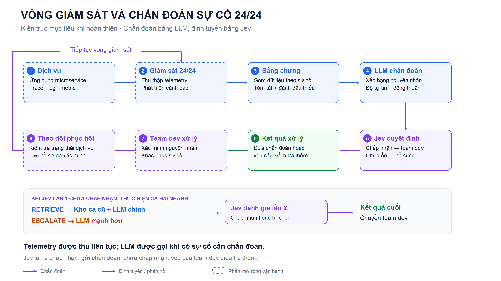
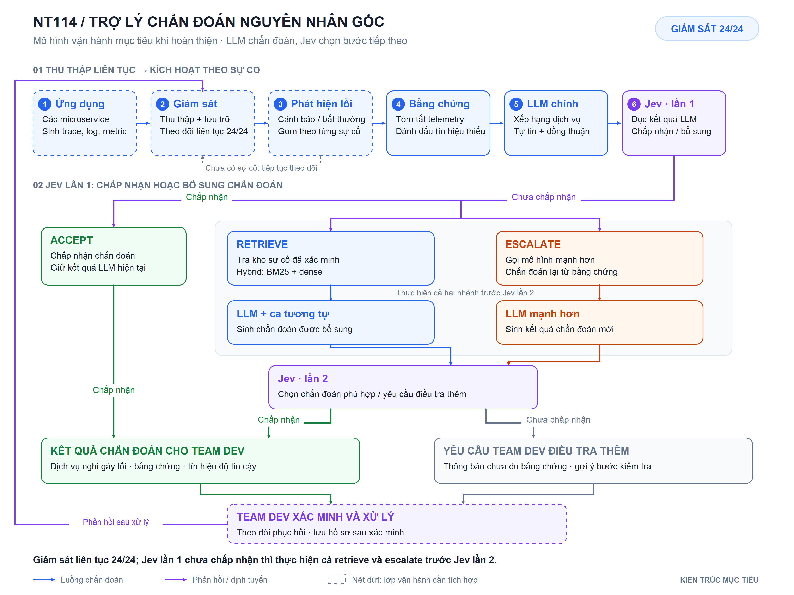

# Pipeline vận hành liên tục của trợ lý chẩn đoán sự cố NT114

**Mục đích:** trình bày mô hình hoạt động của hệ thống khi hoàn thiện, giữ LLM làm nhiệm vụ chẩn đoán và Jev làm lớp lựa chọn hành động.

Đây là kiến trúc vận hành mục tiêu, điều chỉnh theo yêu cầu ngày 16/10/2026: Jev lần 1 chỉ chấp nhận hoặc yêu cầu bổ sung; khi cần bổ sung, thực hiện cả retrieve và escalate trước Jev lần 2. Repository hiện tại tổ chức suy luận và đánh giá theo lưới offline; việc thu thập telemetry trực tiếp, kích hoạt theo cảnh báo và nối quy trình xử lý của team dev là phần tích hợp vận hành được đề xuất trong sơ đồ. Sơ đồ không xác nhận hệ thống đã được triển khai chạy 24/24.

## 1. Sơ đồ dùng cho slide

**Chú thích hình:** Kiến trúc mục tiêu của trợ lý chẩn đoán nguyên nhân gốc trong môi trường microservice. Hệ thống liên tục thu thập trace, log và metric; khi phát hiện sự cố, dữ liệu được tổng hợp thành bằng chứng cho LLM. Jev đánh giá kết quả qua tối đa hai lần, với bước truy hồi và chuyển mô hình khi kết quả ban đầu chưa được chấp nhận. Team dev xác minh, xử lý và theo dõi trạng thái phục hồi, tạo thành vòng vận hành liên tục.

- [PNG 3840 × 2160](nt114-pipeline-assets/nt114-pipeline-slide.png): chèn trực tiếp vào slide.
- [SVG dạng vector](nt114-pipeline-assets/nt114-pipeline-slide.svg): phóng to và chỉnh sửa bằng công cụ hỗ trợ SVG.

## 2. Sơ đồ chi tiết được chọn để báo cáo

- [PNG 3840 × 2880](nt114-pipeline-assets/nt114-pipeline-24x7.png): dùng cho trang báo cáo hoặc phụ lục.
- [SVG dạng vector](nt114-pipeline-assets/nt114-pipeline-24x7.svg): bản nguồn của sơ đồ chi tiết.

## 3. Luồng hoạt động khi hoàn thiện

1. **Thu thập liên tục.** Các dịch vụ sinh trace, log và metric. Lớp giám sát tiếp nhận và lưu telemetry trong suốt thời gian hệ thống hoạt động.
2. **Kích hoạt theo sự cố.** Cảnh báo hoặc dấu hiệu bất thường tạo một yêu cầu RCA. Khi chưa có sự cố, hệ thống tiếp tục theo dõi. Việc giám sát chạy 24/24; mỗi yêu cầu chẩn đoán được kích hoạt theo sự cố.
3. **Chuẩn bị bằng chứng.** Dữ liệu quanh thời điểm cảnh báo được gom theo sự cố, chuẩn hóa tên dịch vụ và tóm tắt các dấu hiệu bất thường. Những loại telemetry không quan sát được phải được ghi rõ để LLM và Jev biết giới hạn của bằng chứng.
4. **LLM chẩn đoán.** Mô hình chính xếp hạng các dịch vụ nghi gây lỗi. Khi lấy nhiều mẫu, kết quả được tổng hợp cùng độ tự tin tự khai, mức đồng thuận và tín hiệu cho biết bằng chứng chưa đủ.
5. **Jev lần 1 đánh giá.** Nếu chấp nhận, hệ thống gửi chẩn đoán hiện tại cho team dev. Nếu chưa chấp nhận, hệ thống thực hiện cả hai nhánh: truy hồi ca tương tự để LLM chính chẩn đoán lại và gọi mô hình mạnh hơn để cung cấp một kết quả chẩn đoán bổ sung.
6. **Jev lần 2 đánh giá.** Jev xem xét các kết quả bổ sung. Nếu chấp nhận, hệ thống gửi chẩn đoán phù hợp cho team dev; nếu vẫn chưa chấp nhận, hệ thống yêu cầu team dev điều tra thêm và gợi ý bước kiểm tra tiếp. Team dev xác minh, quyết định cách khắc phục và theo dõi telemetry sau xử lý.
7. **Tiếp tục giám sát.** Lớp thu thập vẫn hoạt động trong lúc điều tra và khắc phục. Hồ sơ có kết quả đã xác minh được lưu để phục vụ vận hành và có thể được duyệt bổ sung vào kho ca cũ sau này. Việc lưu hồ sơ không đồng nghĩa với tự động huấn luyện lại mô hình.

| Điểm quyết định | Hệ thống thực hiện | Bước tiếp theo |
|---|---|---|
| **Jev lần 1: chấp nhận** | Giữ kết quả LLM chính. | Chuyển chẩn đoán và bằng chứng cho team dev. |
| **Jev lần 1: chưa chấp nhận** | Thực hiện cả retrieve và escalate: LLM chính sử dụng ca tương tự; mô hình mạnh hơn cung cấp kết quả bổ sung. | Chuyển các kết quả bổ sung tới Jev lần 2. |
| **Jev lần 2: chấp nhận** | Chọn chẩn đoán phù hợp sau bước bổ sung. | Chuyển chẩn đoán và bằng chứng cho team dev. |
| **Jev lần 2: chưa chấp nhận** | Thông báo chưa đủ cơ sở kết luận và cung cấp gợi ý kiểm tra tiếp. | Yêu cầu team dev điều tra thêm. |

Một lượt RCA có một lần Jev nếu kết quả đầu được chấp nhận; nếu chưa được chấp nhận, thực hiện cả retrieve và escalate rồi gọi Jev lần 2. Yêu cầu team dev điều tra thêm chỉ xuất hiện sau lần đánh giá thứ hai. Vòng liên tục ở bên ngoài là vòng giám sát, phát hiện, xử lý và theo dõi phục hồi. Nếu sự cố còn tiếp diễn, lớp vận hành cần quản lý các lượt cập nhật theo sự cố và giới hạn tần suất gọi mô hình.

## 4. Đoạn thuyết minh khi báo cáo

> Khi hoàn thiện, hệ thống sẽ hoạt động theo vòng giám sát liên tục 24/24. Trace, log và metric từ các microservice được thu thập thường xuyên. Khi xuất hiện cảnh báo, hệ thống gom dữ liệu của sự cố và tóm tắt thành bằng chứng cho LLM xác định dịch vụ nghi gây lỗi. Jev đánh giá kết quả lần đầu: nếu chấp nhận thì chuyển chẩn đoán cho team dev; nếu chưa chấp nhận thì hệ thống truy hồi sự cố tương tự để bổ sung cho LLM chính, đồng thời gọi mô hình mạnh hơn. Các kết quả bổ sung được chuyển sang Jev đánh giá lần hai. Nếu chấp nhận, hệ thống gửi chẩn đoán phù hợp cho team dev; nếu vẫn chưa đủ cơ sở, hệ thống yêu cầu team dev điều tra thêm. Trong suốt quá trình đó, lớp giám sát tiếp tục theo dõi trạng thái dịch vụ và mức độ phục hồi sau xử lý.

## 5. Phạm vi và cơ sở thiết kế

Nét đứt trên sơ đồ thể hiện các thành phần tích hợp vận hành cần bổ sung: nguồn telemetry trực tiếp, bộ thu thập và phát hiện sự cố, giao diện hoặc kênh chuyển kết quả, theo dõi phục hồi và lưu phản hồi của team dev. Các khối còn lại mô tả thiết kế chẩn đoán mục tiêu sử dụng các thành phần của project; ký hiệu này không xác nhận chúng đã được kiểm chứng bằng mô hình thật trong môi trường sản xuất.

Luồng mục tiêu được chọn ở đây khác hợp đồng hiện tại trong code: code còn cho phép abstain ngay lần đầu và đánh giá riêng trạng thái sau retrieve hoặc escalate. Việc bỏ abstain ở lần đầu, chạy cả hai nhánh bổ sung và để Jev lần 2 chọn giữa các chẩn đoán là thay đổi thiết kế cho bản báo cáo này; source và kế hoạch thực nghiệm chưa được sửa theo thiết kế mới.

Mốc sự cố trong benchmark hiện tại lấy từ dữ liệu thí nghiệm. Khi nối nguồn trực tiếp, cần thay bằng thời điểm cảnh báo hoặc thời điểm khởi phát ước lượng; độ dài cửa sổ dữ liệu và thời gian chờ bằng chứng phải được xác định theo yêu cầu vận hành. Bộ phát hiện bất thường trực tuyến chưa được lựa chọn trong sơ đồ này.

Chấp nhận của Jev là một quyết định định tuyến; kết quả vẫn cần được xác minh. Điểm số Jev không được coi là xác suất chẩn đoán đúng đã hiệu chỉnh. Nhánh truy hồi chỉ xuất hiện khi có kho sự cố phù hợp và được phép sử dụng. Đáp án của sự cố đang xét không được đưa vào prompt hoặc trạng thái Jev.

Các điểm đối chiếu trong repository:

- [Thiết kế kiến trúc, mục 1 và 4.1](../261015-0047-nt114-rca-llm-jev-research-and-implementation/design/architecture.md): nghiên cứu offline và luồng lựa chọn hành động theo từng sự cố.
- [Jev: `build_state`, `build_questions`](../../nt114-rca/nt114-rca/src/rca/jev.py): trạng thái đầu vào và hợp đồng hành động hiện tại, cần điều chỉnh khi triển khai luồng mục tiêu mới.
- [Decision runner: `decision_inputs`, `available_actions`](../../nt114-rca/nt114-rca/src/rca/decide.py): ranh giới dữ liệu, các nhánh theo điều kiện khả dụng và đánh giá các trạng thái offline.
- [Evidence builder](../../nt114-rca/nt114-rca/src/rca/evidence.py): tóm tắt metric, log, trace và cửa sổ dữ liệu benchmark.
- [LLM: `aggregate`](../../nt114-rca/nt114-rca/src/rca/llm.py): tổng hợp xếp hạng, độ tự tin và mức đồng thuận.
- [Truy hồi: `CaseStore.search`](../../nt114-rca/nt114-rca/src/rca/retrieve.py): BM25, dense và hybrid.
- [Decision log](../261015-0047-nt114-rca-llm-jev-research-and-implementation/decisions.md): Jev là lớp quyết định bắt buộc; demo Kubernetes trực tiếp nằm ngoài phạm vi nghiên cứu hiện tại. Hình vận hành tương lai không thay đổi quyết định triển khai đó.
